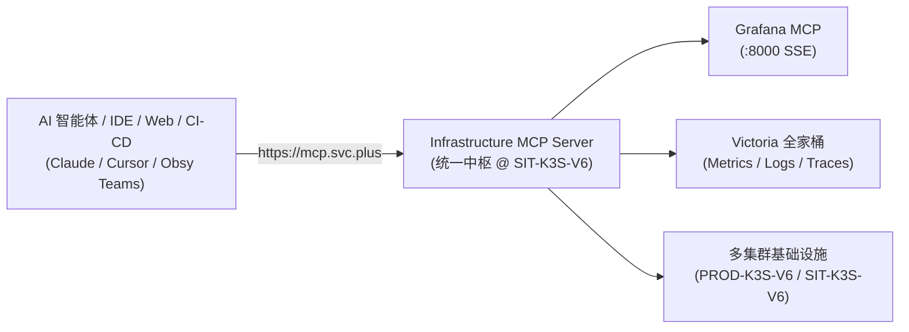

# Infrastructure MCP Server

[]()
[]()
[-success.svg)]()

Infrastructure MCP Server 是多云基础设施与可观测性系统的统一 AI Agent 网关与智能路由器。它为上游各类 Code Agent、AI Agent Teams 及自动化流水线提供标准化的基础设施操作与可观测性入口，并向下聚合级联 Grafana MCP 与 Victoria 全家桶（Metrics / Logs / Traces）。



---

## 🚀 统一入口与运行环境

| 属性 | 运行参数 | 说明 |
| :--- | :--- | :--- |
| **主入口域名** | **`https://mcp.svc.plus`** | 统一公网安全 HTTPS 接入点 |
| **集群与节点** | `SIT-K3S-V6` (`172.237.9.58:443`) | 命名空间：`platform-mcp-sit`，1/1 Running |
| **TLS 证书** | `shared-observability-tls` | Let's Encrypt 权威签发，覆盖 `*.svc.plus` 与 `svc.plus` |
| **兼容别名** | `https://mcp.sit.onwalk.net` | 历史兼容域名保持平滑透传 |

---

## 🔌 4 种智能体接入模式

Infrastructure MCP Server 提供 4 种全场景接入模式：

| 接入模式 | 适用场景 | 核心入口 / 协议 |
| :--- | :--- | :--- |
| **Mode 1: Web REST API** | Web SaaS 控制台、CI/CD 运维脚本、自动化流水线 | `GET/POST https://mcp.svc.plus/api/v1/...` |
| **Mode 2: MCP Tool Call** | 第三方 AI Agent 运行时通用调用 | `POST https://mcp.svc.plus/api/v1/tools/call` |
| **Mode 3: Server-Sent Events** | AI Agent Teams 协同、实时态势感知与监听 | `GET https://mcp.svc.plus/api/v1/events?env=sit` |
| **Mode 4: 标准 stdio 管道** | Claude Desktop、Cursor、Antigravity 原生交互 | 进程标准输入输出 (`stdin`/`stdout`) |

---

## 🛠️ 17 个内置核心工具一览

- **网关与域名路由**：`infra.gateway.query`、`infra.domains.query`
- **动态拓扑与图谱**：`infra.topology.query`、`infra.graph.query`
- **三位一体可观测性**：`infra.metrics.query`、`infra.logs.query`、`infra.traces.query`、`infra.telemetry.query`、`infra.observability.status`
- **渐进式发布与服务目录**：`infra.flagger.status`、`infra.api_catalog.query`
- **多云资产与安全运维**：`infra.cmdb.query`、`infra.cmdb.summary`、`infra.cmdb.sync`、`infra.cli.exec`、`infra.backends`、`infra.health`

---

## 📚 详细文档导航

详细架构、协议规范、能力字典与实盘用例请参阅 `docs/` 目录：

- 🏗️ **[架构设计与拓扑规范](docs/architecture.md)**：统一入口架构、多集群划分、无硬编码动态探测与下游级联规范。
- 🔌 **[4 种接入模式深度详解](docs/access-modes.md)**：Web REST API 路由表、MCP 通用调用契约、SSE 流规范与 stdio 细节。
- 🔍 **[17 个工具与全维度查询规范](docs/query-capabilities.md)**：每个工具的入参、返回格式、数据源与业务场景。
- 🧪 **[外部调用测试与实盘用例](docs/testing-and-verification.md)**：包含实测 curl 命令、入参出参报文及验证结果。
- 💡 **[IDE 客户端接入速查 (TL;DR)](TLDR.md)**：Trae、Cursor、Cherry Studio、Claude Desktop 配置示例与避坑提示。

---

## ⚡ 快速体验

```bash
# 1. 探针检查与元数据获取
curl -s --resolve mcp.svc.plus:443:172.237.9.58 "https://mcp.svc.plus/" | jq .

# 2. 查询平台全量域名与 TLS 状态 (Mode 1)
curl -s --resolve mcp.svc.plus:443:172.237.9.58 "https://mcp.svc.plus/api/v1/domains" | jq .

# 3. 智能体通用工具调用 (Mode 2)
curl --http1.1 -s --resolve mcp.svc.plus:443:172.237.9.58 -X POST \
  "https://mcp.svc.plus/api/v1/tools/call" \
  -H "Content-Type: application/json" \
  -d '{"name": "infra.metrics.query", "arguments": {"query": "probe_success"}}' | jq .
```

---

## 📄 License

Apache License 2.0.
