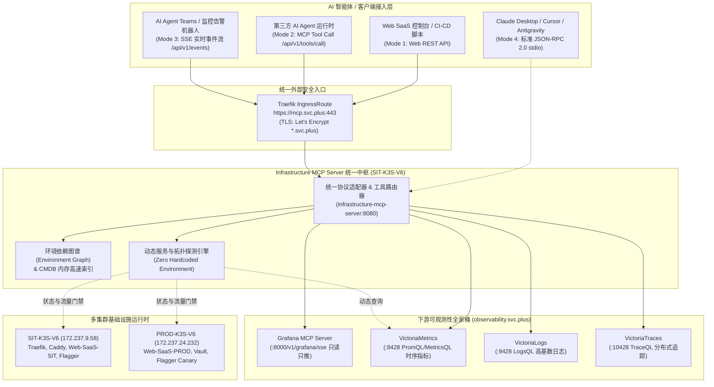

# Infrastructure MCP Server 统一架构规范

Infrastructure MCP Server 是统一的基础设施 AI Agent 网关与智能路由器。它为上游各类智能体（Claude Desktop、Cursor、Antigravity、Web 控制台及第三方 AI Agent Teams）提供稳定的多云、多集群基础设施操作与状态观测入口，并向下聚合级联各类底层 MCP Server 与可观测性数据源。

---

## 1. 架构拓扑全景

---

## 2. 核心架构设计原则

### 2.1 统一入口与证书隔离 (Unified Entrypoint)
- **主入口域名**：`https://mcp.svc.plus`
- **运行宿主机**：SIT-K3S-V6 节点（IP：`172.237.9.58:443`）
- **TLS 权威证书**：绑定 Let's Encrypt 通配符证书 `shared-observability-tls`（覆盖 `*.svc.plus` 及 `svc.plus`，证书自动续期至 2027 年）。
- **向后兼容**：保留历史别名 `mcp.sit.onwalk.net` 与 `mcp-sit.onwalk.net` 的路由解析并保持透传兼容。

### 2.2 零硬编码动态拓扑发现 (Zero Hardcoded Topology)
系统严禁在代码中写死环境（如 `dev`、`sit`、`prod`）或节点列表：
1. **指标与服务发现**：自动通过 VictoriaMetrics `vmetrics/api/v1/series` 实时抓取活跃标签（`job`、`env`、`environment`、`cluster`）。
2. **集群与节点发现**：动态从 CMDB 同步及 K3s 节点状态对账得出各计算节点状态（`PROD-K3S-V6` / `SIT-K3S-V6`）。
3. **金丝雀灰度门禁**：通过 Flagger CRD 实时状态动态聚合 Canary 权重、迭代步进与门禁判定。

### 2.3 下游 MCP 与数据源级联代理 (Downstream Cascade)
Infrastructure MCP Server 既是智能体的直接服务端，也是下游异构工具的聚合网关：
- **Grafana MCP**：通过 SSE 传输挂载，只读模式隔离。
- **VictoriaMetrics / VictoriaLogs / VictoriaTraces**：内置原生 HTTP 客户端，直接代理执行 PromQL、MetricsQL、LogsQL 与 TraceQL 查询并格式化为标准 MCP Tool Content。
- **CMDB & 图谱存储**：采用双层设计（内存并发安全图谱 + 后端 PostgreSQL/pgvector 同步回写）。
